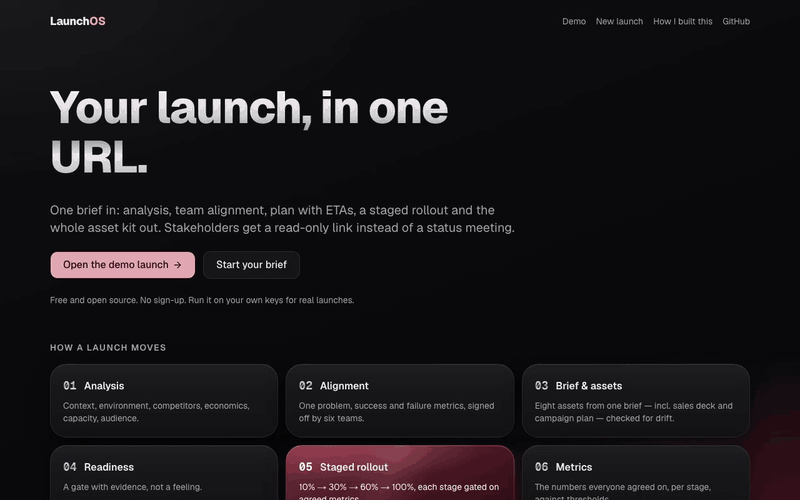
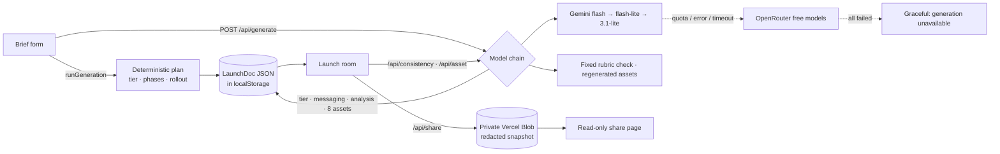

# LaunchOS — your launch, in one URL

**Made by [Iryna Kotovych](https://www.linkedin.com/in/irynakotovych/) · Product Manager / Product Marketing**

**Live demo: [launchos-five.vercel.app/demo](https://launchos-five.vercel.app/demo)** · no sign-up · [How I built this](https://launchos-five.vercel.app/how)



LaunchOS is an open-source **launch room**: one page that holds everything about a product or
feature launch, and keeps it consistent.

- **Analysis** — six areas (context, environment, competitors, economics, capacity, audience), each
  as three key facts with a detail page. AI drafts say "Needs input" instead of inventing numbers.
- **Alignment** — one problem, expected results for the user, company impact (revenue vs. expenses),
  exactly 3 success + 2 failure metrics, sign-off from six teams.
- **Plan** — tier with rationale, phases with ETAs, a live countdown to launch day, readiness
  checklist, and small "suggestion" popups for likely bottlenecks.
- **Staged rollout** — 10% → 30% → 60% → 100%, each stage gated on the failure metrics, with a
  stage-complete message for stakeholders and team leads, and a 100% flag.
- **Metrics dashboard** — the agreed metrics per stage against their thresholds (manual or CSV).
- **Asset kit** — eight drafts from one brief: release notes, blog, email, LinkedIn, sales one-pager,
  FAQ, sales deck + demo script, campaign integration plan.
- **Drift control** — a fixed-rubric consistency check flags assets that contradict the brief; editing
  the brief marks every asset stale.
- **Share** — read-only links (redacted, unguessable, deletable, 90-day expiry) and JSON export/import.

## Architecture



- **One launch = one portable `LaunchDoc`** (no database). Own launches live in the browser;
  share links store a redacted snapshot in private Vercel Blob.
- **Prompts are versioned files** in `prompts/`; every model output records model id + prompt version.
- **Guards**: per-client throttle, daily budget (Blob counter, fails closed), request deadline under
  `maxDuration`, typed JSON on every failure — never an error screen.
- **Stack**: Next.js 15 (App Router) · TypeScript · Tailwind 4 · shadcn/ui · Vercel AI SDK ·
  Vercel Blob · PostHog · Vitest · Playwright.

## Run it with your own keys (BYO-key)
```bash
git clone https://github.com/iryna-kotovych/launchos.git && cd launchos
cp .env.example .env.local   # every value is optional — see "Environment variables" below
npm ci
npm run dev                  # http://localhost:3000
```
Without any keys the app runs fully (demo, plan, editing, export) and shows a graceful
"generation unavailable" state; add `GOOGLE_GENERATIVE_AI_API_KEY` (free in Google AI Studio) for
live generation. Your launches, your tokens, your data — launches stay in your browser.

## What's where and why

| Path | What it is | Why it matters |
|---|---|---|
| `README.md` | This file — the map | First thing a visitor (or hiring manager) reads |
| `CLAUDE.md` | Working rules for Claude Code sessions: stack, PR workflow, visual QA, honesty rules, attribution | The project is built by directing AI agents; this file is how they're directed |
| `docs/PRD.md` | Product requirements: problem, users, jobs-to-be-done, v1 scope, key decisions, risks | Written **before** the first line of code — product thinking first |
| `docs/positioning.md` | Dunford-style canvas + message hierarchy for LaunchOS itself | A launch tool must be sharply positioned; also an honest note on competitors |
| `docs/launch-plan.md` | The plan for launching LaunchOS (tiers, phases, checklist, channels) | The tool plans its own launch — methodology eating its own dog food |
| `docs/metrics.md` | North star (launch-room activation), metrics tree, first A/B experiments | Defines "working"; events are wired to PostHog with exactly these names |
| `docs/decisions-log.md` | Dated one-liners for every judgment call made during the build | The paper trail of autonomous agent work — and the owner's pre-interview cheat sheet |
| `kickoff-prompt.md` | The prompts that drive the build: one intake interview, then milestones M1–M4 hands-off | Reproducibility: anyone can see exactly how this was built |
| `.claude/settings.json` | Pre-approved permissions for Claude Code | Lets agents install, commit, open and merge PRs without interrupting the owner |
| `.env.example` | Every environment variable, all optional | BYO-key: copy to `.env.local`, fill in, never committed |
| `src/`, `prompts/`, `data/` | App code; versioned LLM prompts incl. the consistency rubric; the fictional demo launch | Prompts are product artifacts, not code internals |
| `scripts/`, `qa-shots/` | Playwright QA scripts; screenshots at 390 / 768 / 1440 | Proof every screen was looked at |

## How this was built
With [Claude Code](https://claude.com/claude-code). I wrote the docs and the kickoff prompts and
made the product calls; AI agents built the app through small pull requests — each with a
reviewer-grade description, an automated `@claude` review, a reply to every comment, and visual QA
screenshots. Read the [merged PRs](https://github.com/iryna-kotovych/launchos/pulls?q=is%3Apr+is%3Amerged),
the [decisions log](docs/decisions-log.md) and [How I built this](https://launchos-five.vercel.app/how).

## Key decisions
- **BYO-key over accounts** — the hosted app is a showcase with capped live runs; real use is a fork
  on your own keys. No customer data is stored.
- **One portable JSON per launch** — no database in v1; export/import and redacted share snapshots.
- **Honesty as a feature** — demo labelled everywhere, every AI output a draft with its model id,
  analysis facts the brief can't support shown as "Needs input" (enforced in code).
- **Staged rollout gated on failure metrics** — success metrics are tracked toward launch day; a
  failing gate can only be overridden with a logged reason.
- More in [docs/decisions-log.md](docs/decisions-log.md) — one dated line per judgment call.

## Limitations
- Launches live in one browser (no sync); multi-tab editing is last-writer-wins.
- Stage messages open in your mail app — LaunchOS doesn't send or track email.
- Metric readings are manual or CSV; no live analytics connectors yet.
- Free model tiers rate-limit; a partial kit can ship and the room says which assets failed.
- English only.

## Environment variables
All optional — without model keys the app still works and shows a graceful "generation unavailable" state.

| Variable | Used for |
|---|---|
| `GOOGLE_GENERATIVE_AI_API_KEY` | Primary model (Gemini) |
| `OPENROUTER_API_KEY` | Fallback models (OpenRouter free tier) |
| `LAUNCHOS_PRIMARY_MODEL` / `LAUNCHOS_FALLBACK_MODELS` | Override model ids, comma-separated (Gemini list / OpenRouter list) |
| `BLOB_READ_WRITE_TOKEN` | Share links + daily budget counter (Vercel Blob); in-memory without it |
| `LAUNCHOS_DAILY_LIVE_RUNS` | Daily live-generation cap (default 25, `0` = unlimited) |
| `LAUNCHOS_RUNS_PER_CLIENT_HOUR` | Per-client hourly cap (default 3, `0` = off) |
| `NEXT_PUBLIC_POSTHOG_KEY` / `NEXT_PUBLIC_POSTHOG_HOST` | Product analytics (PostHog) — events exactly as in docs/metrics.md; privacy defaults: no cookies, no autocapture |
| `NEXT_PUBLIC_SITE_URL` | Absolute base URL for link previews when self-hosting (Vercel sets it automatically) |
| `LAUNCHOS_QA` | `1` enables the demo's `?now=` time override in production builds, for visual QA only |

### Limits on a public deployment
The daily cap and per-client throttle are soft guards for a free-tier showcase: the daily
counter is a non-atomic read-modify-write in Blob (concurrent requests can overshoot by a few
runs), and per-client limits live in memory per server instance. Per-client identity comes from
`x-vercel-forwarded-for` on Vercel; when self-hosting behind another proxy, make sure it
overwrites `x-real-ip` / `x-forwarded-for`, or the per-client limit can be spoofed.

## Visual QA
```bash
npx playwright install chromium   # once
npm run build && LAUNCHOS_QA=1 npm start
npm run qa:visual                 # every route at 390 / 768 / 1440 into /qa-shots
npm run qa:long-inputs            # 60-char name, 300-char claim; generation stubbed
npm run qa:edit-flow | qa:rollout-flow | qa:share-flow | qa:sections | qa:viewport
npm run qa:consistency            # QA_STUB_CONSISTENCY=1 to use a fixture
npm run qa:live-generate          # one LIVE generation (uses your keys and budget)
npm run qa:analytics              # analytics events fire (PostHog requests intercepted, nothing sent)
node scripts/record-demo-gif.mjs  # re-record docs/media/demo.gif (needs ffmpeg on PATH)
```
All scripts honour `BASE_URL` (default http://localhost:3000).

## License
MIT © 2026 Iryna Kotovych
